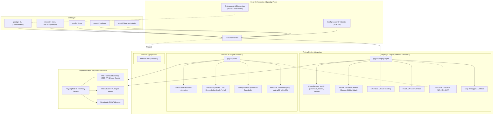

# GoodGirl CLI

[](https://github.com/Loydie123/goodgirl/actions/workflows/ci.yml)
[](https://nodejs.org)
[](https://www.typescriptlang.org)
[](https://pnpm.io)

An all-in-one, CLI-first QA automation toolkit for end-to-end browser, REST API, and high-performance load testing. Engineered with TypeScript, pnpm Workspaces, Turborepo, Playwright Test, and native Grafana k6 integration for cross-platform reliability on Windows (PowerShell), macOS, and Linux.

```text
   ____                 _     ____   _          _ 
  / ___| ___   ___   __| |   / ___| (_)  _ __  | |
 | |  _ / _ \ / _ \ / _' |  | |  _  | | | '__| | |
 | |_| | (_) | (_) | (_| |  | |_| | | | | |    | |
  \____|\___/ \___/ \__,_|   \____| |_| |_|    |_|

 GoodGirl CLI — All-in-One QA Automation Toolkit v0.1.0
```

## Features

- **CLI-First Architecture**: Run tests directly from the terminal or CI runners without heavy GUI wrappers.
- **Deep Playwright Integration**: Direct access to Playwright Test features: Chromium, Firefox, WebKit, mobile emulation, step inspector, UI mode, tracing, and codegen.
- **Deep Grafana k6 Integration**: Native k6 engine integration executing real virtual user load scenarios, latency percentiles (`avg`, `med`, `p90`, `p95`, `p99`), error rates, request throughput, and thresholds.
- **Performance Scenarios & Presets**: Out-of-the-box support for smoke, load, stress, spike, soak, and arrival-rate traffic shapes with ramping stages.
- **Cross-Browser & Matrix Testing**: Configure multi-browser projects, custom device viewports, and parallel worker pools.
- **Safety & Target Guardrails**: Safe-by-default execution restricting traffic to local test benches (`localhost`, `127.0.0.1`) unless explicitly unlocked via `--allow-external`.
- **Interactive Terminal UI**: Optional `@clack/prompts` menu for exploratory test runs and diagnostics.
- **Tri-Discipline Testing**: Execute browser user journeys, REST API contract checks, and high-performance load tests with unified tooling.
- **Debugging & Telemetry**: Built-in trace viewing (`goodgirl trace`), test recorder (`goodgirl codegen`), interactive report server (`goodgirl report --open`), and flaky test tracking.
- **Argument Passthrough**: Forward raw native Playwright and k6 flags directly using `--` (e.g. `goodgirl test all -- --workers=1` or `goodgirl load run script.js -- --http-debug`).
- **Cross-Platform Native**: Tested and validated on Windows PowerShell, macOS, and Linux.
- **Hermetic Fixture Server**: Built-in HTTP test bench (`127.0.0.1:4173`) for running verification suites offline.

## Testing Engines

| Engine | Discipline | Capabilities | Status |
|:---|:---|:---|:---:|
| **Playwright** | Functional E2E & REST API | Multi-browser matrix (Chromium, Firefox, WebKit), device emulation, route mocking, traces, video, codegen | **Implemented (Phase 2)** |
| **Grafana k6** | Performance & Load | Native k6 execution, virtual user load simulation, latency percentiles (p90, p95, p99), checks, thresholds, safety guardrails | **Implemented (Phase 3)** |
| **OWASP ZAP** | Application Security | Automated vulnerability scanning, baseline proxy inspection | *Planned (Phase 4)* |

> [!NOTE]
> Phase 1 & 2 provide advanced **Playwright** capabilities: cross-browser execution (Chromium, Firefox, WebKit), device emulation presets, debug inspector, interactive UI mode, trace viewer, codegen, network mocking, and argument passthrough. Phase 3 introduces deep **Grafana k6** integration for high-performance load, stress, spike, soak, and custom metric testing with threshold enforcement and safety controls. OWASP ZAP integration is planned for Phase 4.

## Quick Start

### Windows (PowerShell)

```powershell
# 1. Clone repository
git clone https://github.com/Loydie123/goodgirl.git
Set-Location goodgirl

# 2. Install dependencies
pnpm install --frozen-lockfile

# 3. Build workspace packages
pnpm build

# 4. Install Playwright browser binaries
pnpm exec playwright install chromium firefox webkit

# 5. Install Grafana k6 (Optional for load testing)
winget install k6 --source winget
# (Alternative: choco install k6)

# 6. Run environment diagnostics
pnpm qa doctor
pnpm qa load doctor

# 7. Execute smoke tests
pnpm qa test all
pnpm qa load run examples/k6/smoke.js
```

### macOS & Linux

```bash
# 1. Clone repository
git clone https://github.com/Loydie123/goodgirl.git
cd goodgirl

# 2. Install dependencies
pnpm install --frozen-lockfile

# 3. Build workspace packages
pnpm build

# 4. Install Playwright browser binaries
pnpm exec playwright install chromium firefox webkit
# (Ubuntu/Debian: if system libraries are needed: pnpm exec playwright install --with-deps chromium firefox webkit)

# 5. Install Grafana k6 (Optional for load testing)
# macOS:
brew install k6
# Linux:
# See: https://grafana.com/docs/k6/latest/set-up/install-k6/
sudo apt-get install k6

# 6. Run environment diagnostics
pnpm qa doctor
pnpm qa load doctor

# 7. Execute smoke tests
pnpm qa test all
pnpm qa load run examples/k6/smoke.js
```

## Usage

### Interactive Menu

Launch GoodGirl without arguments to start the interactive terminal interface:

```bash
pnpm qa
```

```text
GoodGirl CLI — Interactive QA Menu
┌  Select an action:
│  ● Run E2E Tests       (Execute end-to-end browser tests)
│  ○ Run API Tests       (Execute API endpoint test suite)
│  ○ Run All Tests       (Execute full E2E and API test suite)
│  ○ Run Load Tests      (Execute Grafana k6 performance tests)
│  ○ Generate Report     (View latest HTML or JSON test report)
│  ○ Check Environment   (Validate system prerequisites & config)
│  ○ Exit                (Close GoodGirl CLI)
└
```

### Command Line Interface

```bash
# Run all test suites (E2E and API)
pnpm qa test all

# Run specific test file or directory
pnpm qa test tests/e2e/login.spec.ts

# Run tests on specific browser engine
pnpm qa test e2e --browser firefox
pnpm qa test e2e --browser webkit
pnpm qa test all --browser all

# Run specific project or device preset
pnpm qa test --project "Mobile Chrome"

# Run tests in headed browser mode
pnpm qa test e2e --headed

# Launch Playwright step-by-step inspector debugger
pnpm qa test --debug

# Open interactive Playwright UI mode
pnpm qa test --ui

# Record execution traces or videos
pnpm qa test all --trace on --video on

# Filter tests by title regex pattern or tag
pnpm qa test all --grep "health"
pnpm qa test all --grep-invert "slow"

# Concurrency, retries, and failure limits
pnpm qa test all --workers 4 --retries 2 --max-failures 1

# Only re-run tests that failed in previous run
pnpm qa test all --last-failed

# Forward native Playwright arguments directly
pnpm qa test all -- --workers=1 --ignore-snapshots

# Open Playwright Trace Viewer for inspection
pnpm qa trace
pnpm qa trace goodgirl-results/trace.zip

# Launch Playwright Codegen test recorder
pnpm qa codegen https://example.com
pnpm qa codegen https://example.com --device "iPhone 13"

# Run k6 load doctor diagnostics
pnpm qa load doctor

# Run smoke performance test against local fixture
pnpm qa load run examples/k6/smoke.js

# Run load test with custom virtual users and duration
pnpm qa load run examples/k6/load.js --vus 25 --duration 30s

# Run multi-stage ramping stress test
pnpm qa load run examples/k6/stress.js --stage 10s:10 --stage 20s:20 --stage 10s:0

# Pass environment variables to k6 script
pnpm qa load run examples/k6/smoke.js --env TARGET_URL=http://127.0.0.1:4173/api/health

# Permit external host testing (safeguard override)
pnpm qa load run examples/k6/smoke.js --allow-external

# Forward raw native k6 arguments directly
pnpm qa load run examples/k6/smoke.js -- --http-debug="full"

# View or serve HTML/JSON reports
pnpm qa report
pnpm qa report --open
pnpm qa report --format json

# Initialize GoodGirl configuration in a project
pnpm qa init

# Run system and browser diagnostics
pnpm qa doctor
```

### Command Reference

| Command | Key Options | Description |
|---|---|---|
| `goodgirl` | *(none)* | Opens interactive terminal menu |
| `goodgirl test [files...]` | `--browser`, `--project`, `--headed`, `--workers`, `--retries`, `--debug`, `--ui`, `--trace`, `--video` | Runs test suites with full Playwright controls |
| `goodgirl test e2e [files...]` | *(same as test)* | Runs only end-to-end browser test cases |
| `goodgirl test api [files...]` | *(same as test)* | Runs only REST API contract test cases |
| `goodgirl test all [files...]` | *(same as test)* | Runs both E2E browser and REST API test suites |
| `goodgirl trace [path]` | `[path]` | Launches Playwright Trace Viewer (auto-detects recent trace archive) |
| `goodgirl codegen [url]` | `-b, --browser`, `--device`, `-o, --output` | Launches interactive browser test recorder |
| `goodgirl load doctor` | `-c, --config <path>` | Diagnoses k6 binary installation, version, runtime features, and workspace permissions |
| `goodgirl load run <script>` | `--vus`, `--duration`, `--iterations`, `--stage`, `--env`, `--summary-export`, `--json-report`, `--allow-external`, `--raw` | Executes k6 performance script with scenario controls, threshold checks, and metric reporting |
| `goodgirl report` | `-f, --format <html\|json>`, `-o, --open`, `-c, --config <path>` | Displays report URL, serves interactive HTML viewer, or prints JSON |
| `goodgirl doctor` | `-c, --config <path>` | Diagnoses Node.js, pnpm, OS, Playwright browsers, config, and permissions |
| `goodgirl init` | `-f, --force` | Scaffolds `goodgirl.config.ts`, `tests/e2e/`, and `tests/api/` |

### Terminal Output Preview

#### Playwright Functional Test Suite
```text
$ goodgirl test all

🚀 Starting GoodGirl ALL test suite...

Running 6 tests using 2 workers
  ✔  1 [api] › GET /api/health returns 200 and conforms to health schema (21ms)
  ✔  2 [api] › GET /api/users returns 200 and list of test users (6ms)
  ✔  3 [api] › POST /api/items creates item and returns 201 on valid body (4ms)
  ✔  4 [api] › POST /api/items returns 400 with validation error when payload is empty (5ms)
  ✔  5 [e2e] › homepage loads successfully and displays expected heading (141ms)
  ✔  6 [e2e] › user interaction triggers action and updates status message (138ms)

────────────────────────────────────────────────────────
 GoodGirl Test Execution Summary
────────────────────────────────────────────────────────
  Overall Status:  ✔ PASSED
  Total Tests:     6 | Passed: 6 | Failed: 0 | Skipped: 0 | Flaky (Retried): 0
  Duration:        755ms
  HTML Report:     goodgirl-results/html/index.html
  JSON Report:     goodgirl-results/results.json
────────────────────────────────────────────────────────
```

#### Grafana k6 Load Test Suite
```text
$ goodgirl load run examples/k6/smoke.js

────────────────────────────────────────────────────────────
 GoodGirl Load Test Summary (Grafana k6)
────────────────────────────────────────────────────────────
  Target Script:     examples/k6/smoke.js
  Overall Status:    ✔ PASSED
  Thresholds:        ✔ Satisfied
  Duration:          3.36s
  Virtual Users:     max=1, current=1
────────────────────────────────────────────────────────────
 HTTP Latency (http_req_duration):
    avg: 0.7ms  med: 0.4ms  min: 0.1ms  max: 6.1ms
    p(90): 1.4ms  p(95): 2.4ms  p(99): 4.1ms
────────────────────────────────────────────────────────────
 Throughput & Requests:
    Total Requests:  58 (19.3 req/s)
    Failed Requests: 0 (0.00%)
    Data Received:   21.0 kB (7.0 kB/s)
────────────────────────────────────────────────────────────
 Threshold Results:
    ✔ http_req_duration: p(95)<400 [PASSED]
    ✔ http_req_failed: rate<0.01 [PASSED]
    ✔ checks: rate>0.99 [PASSED]
────────────────────────────────────────────────────────────
 Validation Checks:
    ✔ health status is 200 - 100.0% (29/29)
    ✔ service is goodgirl-fixture-server - 100.0% (29/29)
    ✔ users status is 200 - 100.0% (29/29)
    ✔ users list has at least 2 users - 100.0% (29/29)
────────────────────────────────────────────────────────────
  JSON Report:       goodgirl-results/k6-results.json
────────────────────────────────────────────────────────────
```

## Configuration

GoodGirl loads configuration from `goodgirl.config.ts` using strict Zod schemas and runtime validation:

```typescript
import type { GoodGirlConfig } from "@goodgirl/shared";

const config: GoodGirlConfig = {
  projectName: "E-Commerce App QA",
  baseURL: "https://staging.example.com",
  browser: "chromium",
  browsers: ["chromium", "firefox", "webkit"],
  projects: [
    {
      name: "Desktop Chrome",
      browser: "chromium",
    },
    {
      name: "Desktop Firefox",
      browser: "firefox",
    },
    {
      name: "Mobile Safari",
      device: "iPhone 13",
    },
    {
      name: "API Suite",
      testMatch: "**/api/**/*.spec.ts",
    },
  ],
  workers: 4,
  fullyParallel: true,
  timeout: 30000,
  retries: 1,
  screenshots: "only-on-failure",
  trace: "retain-on-failure",
  video: "retain-on-failure",
  testDir: "tests",
  resultsDir: "goodgirl-results",
  use: {
    viewport: { width: 1280, height: 720 },
    ignoreHTTPSErrors: true,
  },
  k6: {
    allowExternal: false,
    summaryTrendStats: ["avg", "min", "med", "max", "p(90)", "p(95)", "p(99)"],
    resultsDir: "goodgirl-results",
  },
};

export default config;
```

### Environment Overrides

Runtime settings can be overridden via environment variables without modifying configuration files:

| Variable | Target Property | Example |
|---|---|---|
| `GOODGIRL_BASE_URL` | `baseURL` | `http://localhost:3000` |
| `GOODGIRL_BROWSER` | `browser` | `chromium`, `firefox`, `webkit` |
| `GOODGIRL_BROWSERS` | `browsers` | `chromium,firefox,webkit` |
| `GOODGIRL_WORKERS` | `workers` | `4` or `50%` |
| `GOODGIRL_FULLY_PARALLEL` | `fullyParallel` | `true`, `false` |
| `GOODGIRL_TIMEOUT` | `timeout` | `45000` |
| `GOODGIRL_RETRIES` | `retries` | `2` |
| `GOODGIRL_TRACE` | `trace` | `on`, `off`, `retain-on-failure` |
| `GOODGIRL_VIDEO` | `video` | `on`, `off`, `retain-on-failure` |
| `GOODGIRL_ALLOW_EXTERNAL` | `k6.allowExternal` | `true`, `false` |

## Writing Tests

### 1. Page Object Model (POM) & Custom Fixtures

Encapsulate UI selectors and workflows in clean Page Objects, and inject them via custom test fixtures:

```typescript
// tests/pages/HomePage.ts
import type { Locator, Page } from "@playwright/test";

export class HomePage {
  readonly heading: Locator;
  readonly actionButton: Locator;

  constructor(readonly page: Page) {
    this.heading = page.locator("h1");
    this.actionButton = page.locator("#action-btn");
  }

  async goto() {
    await this.page.goto("/");
  }

  async triggerAction() {
    await this.actionButton.click();
  }
}
```

```typescript
// tests/fixtures/test.ts
import { test as baseTest, expect } from "@playwright/test";
import { HomePage } from "../pages/HomePage.js";

type TestFixtures = {
  homePage: HomePage;
};

export const test = baseTest.extend<TestFixtures>({
  homePage: async ({ page }, use) => {
    await use(new HomePage(page));
  },
});

export { expect };
```

```typescript
// tests/e2e/app.spec.ts
import { test, expect } from "../fixtures/test.js";

test.describe("User Journey", () => {
  test("user interacts with home page", async ({ homePage }) => {
    await homePage.goto();
    await expect(homePage.heading).toBeVisible();
    await homePage.triggerAction();
  });
});
```

### 2. Network Route Mocking & API Interception

Intercept network requests directly using Playwright's native routing API:

```typescript
// tests/e2e/mocking.spec.ts
import { test, expect } from "../fixtures/test.js";

test.describe("Network Mocking", () => {
  test("intercepts API and fulfills with mock payload", async ({ page, homePage }) => {
    await page.route("**/api/users", async (route) => {
      await route.fulfill({
        status: 200,
        contentType: "application/json",
        body: JSON.stringify([{ id: 1, name: "Mocked User", role: "QA" }]),
      });
    });

    await homePage.goto();
  });

  test("simulates network outage via route abort", async ({ page, homePage }) => {
    await homePage.goto();
    await page.route("**/api/critical-data", (route) => route.abort("failed"));
  });
});
```

### 3. REST API Contract Testing

Execute HTTP requests using `APIRequestContext` without launching a browser:

```typescript
// tests/api/users.spec.ts
import { test, expect } from "@playwright/test";

test.describe("Users API", () => {
  test("GET /api/users returns list of active users", async ({ request }) => {
    const res = await request.get("/api/users");
    expect(res.status()).toBe(200);

    const users = await res.json();
    expect(Array.isArray(users)).toBe(true);
  });
});
```

### 4. Performance & Load Testing (Grafana k6)

Execute high-concurrency performance scripts using the native Grafana k6 engine:

```javascript
// examples/k6/smoke.js
import http from "k6/http";
import { check, sleep } from "k6";

export const options = {
  vus: 1,
  duration: "3s",
  thresholds: {
    http_req_duration: ["p(95)<400"],
    http_req_failed: ["rate<0.01"],
    checks: ["rate>0.99"],
  },
};

export default function () {
  const target = __ENV.TARGET_URL || "http://127.0.0.1:4173";
  const res = http.get(`${target}/api/health`);
  check(res, {
    "health status is 200": (r) => r.status === 200,
  });
  sleep(0.1);
}
```

#### Available Scenario Presets

GoodGirl includes ready-to-run k6 scenario scripts under `examples/k6/`:

| Script | Traffic Model | Purpose |
|---|---|---|
| `examples/k6/smoke.js` | 1 VU, short duration | Baseline sanity check and threshold verification |
| `examples/k6/load.js` | Ramping VUs (5 to 15) | Standard load test assessing nominal performance |
| `examples/k6/stress.js` | Ramping VUs (10 to 40) | Pushes system beyond capacity to identify breaking point |
| `examples/k6/spike.js` | Instant surge (2 to 30 VUs) | Evaluates recovery during and after sudden traffic spikes |
| `examples/k6/soak.js` | Extended duration | Endurance test uncovering memory leaks and degradation |
| `examples/k6/arrival-rate.js` | Constant arrival rate | Open-model request arrival independent of response latency |
| `examples/k6/custom-metrics.js` | Multi-metric telemetry | Tracks custom `Trend`, `Rate`, `Counter`, and `Gauge` |

#### Safety Guardrails

To prevent accidental load injection against remote systems or production services, GoodGirl enforces safe-by-default execution:
- By default, scripts may only target `127.0.0.1` and `localhost`.
- Non-local targets trigger an immediate safety halt.
- To permit remote endpoints, provide the `--allow-external` CLI flag or set `k6.allowExternal: true` in `goodgirl.config.ts`.

> [!NOTE]
> Safety verification relies on static source analysis of script files for literal URLs. It cannot guarantee detection of dynamically concatenated URLs, runtime environment overrides, or server-side HTTP redirects. Operators remain responsible for the endpoints their scripts target.

#### Thresholds & Exit Codes

k6 thresholds evaluate metric criteria (e.g. `p(95)<400ms`, `rate<0.01`). When any threshold fails, GoodGirl propagates k6's native exit code `99`, failing CI pipelines immediately on performance regressions.

## Test Reports & Artifacts

All test runs generate artifacts in `goodgirl-results/` (gitignored):

```text
goodgirl-results/
├── html/                 # Interactive Playwright HTML report
│   └── index.html
├── results.json          # Structured Playwright JSON telemetry
├── k6-results.json       # Parsed Grafana k6 execution report (latency, RPS, checks)
├── k6-summary.json       # Raw Grafana k6 summary-export data
├── trace.zip             # Playwright execution trace archives
└── test-failed-*.png     # Playwright failure screenshots
```

- **Open HTML Report in Browser**: Run `pnpm qa report --open` to serve the report locally.
- **Inspect Execution Trace**: Run `pnpm qa trace` to open the most recent trace in Playwright Trace Viewer.
- **Inspect Playwright Telemetry**: Run `pnpm qa report --format json` to inspect or pipe test telemetry.
- **Inspect Load Test Telemetry**: View formatted terminal output or consume `goodgirl-results/k6-results.json`.

## Architecture



### Monorepo Structure

```text
goodgirl/
├── apps/
│   └── cli/                # CLI entry point, commands, and Clack interactive menu
├── packages/
│   ├── core/               # Orchestrator, Zod validator, diagnostics checker
│   ├── k6/                 # Grafana k6 detector, runner, parser, and safety checks
│   ├── playwright/         # Playwright runner, config factory, fixture server
│   ├── reporter/           # Result parser and ANSI terminal summary formatter
│   └── shared/             # Domain types, constants, path helpers, custom errors
├── examples/
│   ├── k6/                 # Runnable k6 performance test scripts and scenarios
│   └── sample-project/     # Standalone QA sample project with POM and route mocking
├── .github/workflows/      # Cross-platform matrix CI (Windows, macOS, Linux)
├── pnpm-workspace.yaml
├── turbo.json
└── package.json
```

## Development Scripts

| Command | Action |
|---|---|
| `pnpm build` | Compiles all packages via Turborepo (`tsup`) with type definitions |
| `pnpm dev` | Starts interactive watch mode across workspace packages |
| `pnpm lint` | Validates code quality and style using ESLint 9 |
| `pnpm typecheck` | Runs strict TypeScript type checks across all packages |
| `pnpm test` | Executes Vitest unit test suites |
| `pnpm qa` | Runs GoodGirl CLI directly without global installation |
| `pnpm qa doctor` | Runs environment, browser binary, and configuration diagnostics |

## Troubleshooting

### Missing Browser Binary
```text
Error: Cannot find Playwright browser binary
```
**Resolution**: Run `pnpm exec playwright install chromium firefox webkit`. On Linux runners, use `pnpm exec playwright install --with-deps chromium firefox webkit`.

### Port 4173 Already Bound
```text
Error: listen EADDRINUSE: address already in use 127.0.0.1:4173
```
**Resolution**: Another service is using port 4173. Override the port via configuration or environment variable:
```powershell
$env:GOODGIRL_BASE_URL = "http://127.0.0.1:4174"
pnpm qa test all
```

### CI Terminal Menu Hangs
**Resolution**: `@clack/prompts` requires an interactive TTY. In headless CI/CD environments, always pass explicit subcommands (e.g. `pnpm qa test all` or `pnpm qa doctor`).

## Roadmap

- **Phase 1 (Completed)**: Monorepo foundation, Commander CLI, Clack interactive UI, Playwright E2E and API testing, local fixture server, unified reporting, cross-platform CI matrix.
- **Phase 2 (Completed)**: Cross-browser matrix (Chromium, Firefox, WebKit), device emulation presets, debug inspector, interactive UI mode, trace viewer, codegen, network mocking, Page Object Models, custom fixtures, flaky test reporting, and raw argument passthrough.
- **Phase 3 (Completed)**: Deep Grafana k6 engine integration for performance, smoke, load, stress, spike, soak, and arrival-rate testing with threshold enforcement, safety guardrails, and rich metric cards.
- **Phase 4 (Planned)**: OWASP ZAP engine integration for automated security baseline scanning.

## Contributing

Please review [CONTRIBUTING.md](CONTRIBUTING.md) for development workflows, cross-platform rules, and commit conventions.

## License

License decision is currently pending.
