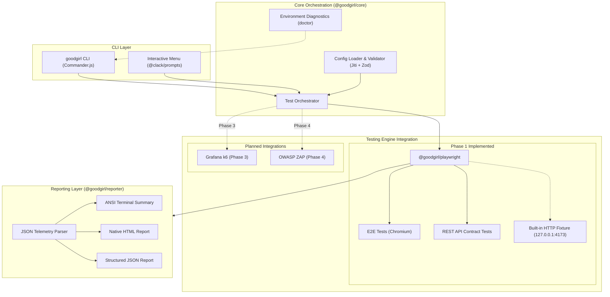

# GoodGirl CLI

[](https://github.com/Loydie123/goodgirl/actions/workflows/ci.yml)
[](https://nodejs.org)
[](https://www.typescriptlang.org)
[](https://pnpm.io)

An all-in-one, CLI-first QA automation toolkit for end-to-end browser and REST API testing. Engineered with TypeScript, pnpm Workspaces, Turborepo, and Playwright for cross-platform reliability on Windows (PowerShell), macOS, and Linux.

```text
   ____                 _     ____   _          _ 
  / ___| ___   ___   __| |   / ___| (_)  _ __  | |
 | |  _ / _ \ / _ \ / _' |  | |  _  | | | '__| | |
 | |_| | (_) | (_) | (_| |  | |_| | | | | |    | |
  \____|\___/ \___/ \__,_|   \____| |_| |_|    |_|

 GoodGirl CLI — All-in-One QA Automation Toolkit v0.1.0
```

## Features

- **CLI-First Architecture**: Run tests directly from the command line or CI runners without heavy GUI wrappers.
- **Interactive Terminal UI**: Optional `@clack/prompts` menu for exploratory test runs and diagnostics.
- **Dual Testing Modes**: Execute full browser journeys (Chromium) and REST API contract checks with shared tooling.
- **Cross-Platform Native**: Tested and validated on Windows PowerShell, macOS, and Linux.
- **Hermetic Fixture Server**: Built-in HTTP test bench (`127.0.0.1:4173`) for running verification suites offline.
- **Actionable Reporting**: ANSI terminal summaries, self-contained Playwright HTML reports, and structured JSON telemetry.

## Testing Engines

| Engine | Discipline | Capabilities | Status |
|:---|:---|:---|:---:|
| **Playwright** | Functional E2E & REST API | Browser automation, Chromium runner, REST API contracts, traces & screenshots | **Implemented (Phase 1)** |
| **Grafana k6** | Performance & Load | Virtual user load simulation, latency percentiles, thresholds | *Planned (Phase 3)* |
| **OWASP ZAP** | Application Security | Automated vulnerability scanning, baseline proxy inspection | *Planned (Phase 4)* |

> [!NOTE]
> Phase 1 delivers complete, production-ready **Playwright** functional E2E and REST API testing. Grafana k6 and OWASP ZAP integrations are planned for future phases.

## Quick Start

### Windows (PowerShell)

```powershell
# 1. Clone repository
git clone https://github.com/Loydie123/goodgirl.git
Set-Location goodgirl

# 2. Install dependencies
pnpm install --frozen-lockfile

# 3. Build workspace packages
pnpm build

# 4. Install Playwright browser binary
pnpm exec playwright install chromium

# 5. Run environment diagnostics
pnpm qa doctor

# 6. Execute smoke tests
pnpm qa test all
```

### macOS & Linux

```bash
# 1. Clone repository
git clone https://github.com/Loydie123/goodgirl.git
cd goodgirl

# 2. Install dependencies
pnpm install --frozen-lockfile

# 3. Build workspace packages
pnpm build

# 4. Install Playwright browser binary
pnpm exec playwright install chromium
# (Ubuntu/Debian: if system libraries are needed: pnpm exec playwright install --with-deps chromium)

# 5. Run environment diagnostics
pnpm qa doctor

# 6. Execute smoke tests
pnpm qa test all
```

## Usage

### Interactive Menu

Launch GoodGirl without arguments to start the interactive terminal interface:

```bash
pnpm qa
```

```text
GoodGirl CLI — Interactive QA Menu
┌  Select an action:
│  ● Run E2E Tests       (Execute end-to-end browser tests)
│  ○ Run API Tests       (Execute API endpoint test suite)
│  ○ Run All Tests       (Execute full E2E and API test suite)
│  ○ Generate Report     (View latest HTML or JSON test report)
│  ○ Check Environment   (Validate system prerequisites & config)
│  ○ Exit                (Close GoodGirl CLI)
└
```

### Command Line Interface

```bash
# Run all test suites (E2E and API)
pnpm qa test all

# Run only E2E browser tests
pnpm qa test e2e

# Run E2E tests in headed mode (visible browser window)
pnpm qa test e2e --headed

# Run only REST API contract tests
pnpm qa test api

# Filter tests by title or tag pattern
pnpm qa test all --grep "health"

# Initialize GoodGirl configuration and starter tests in a project
pnpm qa init

# Run system and environment diagnostics
pnpm qa doctor

# View or export test reports
pnpm qa report --format html
pnpm qa report --format json
```

### Command Reference

| Command | Options | Description |
|---|---|---|
| `goodgirl` | *(none)* | Opens interactive terminal menu |
| `goodgirl --help` | `-h, --help` | Displays command reference |
| `goodgirl --version` | `-V, --version` | Prints installed version (`0.1.0`) |
| `goodgirl init` | `-f, --force` | Scaffolds `goodgirl.config.ts`, `tests/e2e/`, and `tests/api/` |
| `goodgirl doctor` | *(none)* | Diagnoses Node.js, pnpm, OS, Playwright, config, and permissions |
| `goodgirl test all` | `--headed`, `--grep <pattern>`, `-c, --config <path>` | Runs both E2E browser and REST API test suites |
| `goodgirl test e2e` | `--headed`, `--grep <pattern>`, `-c, --config <path>` | Runs only E2E browser test cases |
| `goodgirl test api` | `--grep <pattern>`, `-c, --config <path>` | Runs only REST API test cases |
| `goodgirl report` | `-f, --format <html\|json>`, `-c, --config <path>` | Displays HTML report location or outputs raw JSON |

### Terminal Output Preview

```text
$ goodgirl test all

🚀 Starting GoodGirl ALL test suite...

Running 6 tests using 2 workers
  ✔  1 [api] › GET /api/health returns 200 and conforms to health schema (21ms)
  ✔  2 [api] › GET /api/users returns 200 and list of test users (6ms)
  ✔  3 [api] › POST /api/items creates item and returns 201 on valid body (4ms)
  ✔  4 [api] › POST /api/items returns 400 with validation error when payload is empty (5ms)
  ✔  5 [e2e] › homepage loads successfully and displays expected heading (141ms)
  ✔  6 [e2e] › user interaction triggers action and updates status message (138ms)

────────────────────────────────────────────────────────
 GoodGirl Test Execution Summary
────────────────────────────────────────────────────────
  Overall Status:  ✔ PASSED
  Total Tests:     6 | Passed: 6 | Failed: 0 | Skipped: 0
  Duration:        755ms
  HTML Report:     goodgirl-results/html/index.html
  JSON Report:     goodgirl-results/results.json
────────────────────────────────────────────────────────
```

## Configuration

GoodGirl loads configuration from `goodgirl.config.ts` using strict Zod schemas and runtime validation:

```typescript
import type { GoodGirlConfig } from "@goodgirl/shared";

const config: GoodGirlConfig = {
  projectName: "E-Commerce App QA",
  baseURL: "https://staging.example.com",
  browser: "chromium",
  timeout: 30000,
  retries: 1,
  screenshots: "only-on-failure",
  trace: "retain-on-failure",
  testDir: "tests",
  resultsDir: "goodgirl-results",
};

export default config;
```

### Environment Overrides

Runtime settings can be overridden via environment variables without modifying configuration files:

| Variable | Target Property | Example |
|---|---|---|
| `GOODGIRL_BASE_URL` | `baseURL` | `http://localhost:3000` |
| `GOODGIRL_BROWSER` | `browser` | `chromium`, `firefox`, `webkit` |
| `GOODGIRL_TIMEOUT` | `timeout` | `45000` |
| `GOODGIRL_RETRIES` | `retries` | `2` |

## Writing Tests

### 1. Offline Hermetic Testing (Default)
When `baseURL` targets port `4173` (the default), GoodGirl automatically boots its built-in Node.js HTTP fixture server. You can immediately run E2E and API tests offline without external servers.

### 2. Testing an External Application
Set `baseURL` in `goodgirl.config.ts` (or `GOODGIRL_BASE_URL`) and create test files under `tests/e2e/` or `tests/api/`:

```typescript
// tests/e2e/login.spec.ts
import { test, expect } from "@playwright/test";

test.describe("Authentication", () => {
  test("user submits credentials and reaches dashboard", async ({ page }) => {
    await page.goto("/login");
    await page.locator("#username").fill("qa_engineer");
    await page.locator("#password").fill("SuperSecret123!");
    await page.locator("button[type=submit]").click();

    await expect(page.locator("h1")).toHaveText("Dashboard");
  });
});
```

```typescript
// tests/api/health.spec.ts
import { test, expect } from "@playwright/test";

test.describe("API Health", () => {
  test("GET /api/health responds with 200 and ok status", async ({ request }) => {
    const res = await request.get("/api/health");
    expect(res.status()).toBe(200);

    const body = await res.json();
    expect(body.status).toBe("ok");
  });
});
```

## Test Reports & Artifacts

All test runs generate artifacts in `goodgirl-results/` (gitignored):

```text
goodgirl-results/
├── html/             # Standalone Playwright HTML report
│   └── index.html
└── results.json      # Structured JSON execution telemetry
```

- **View HTML Report**: Run `pnpm qa report --format html` or `pnpm exec playwright show-report goodgirl-results/html`.
- **View JSON Report**: Run `pnpm qa report --format json` to inspect or pipe telemetry.

## Architecture



### Monorepo Structure

```text
goodgirl/
├── apps/
│   └── cli/                # CLI entry point, commands, and Clack interactive menu
├── packages/
│   ├── core/               # Orchestrator, Zod validator, diagnostics checker
│   ├── playwright/         # Playwright runner, config factory, fixture server
│   ├── reporter/           # Result parser and ANSI terminal summary formatter
│   └── shared/             # Domain types, constants, path helpers, custom errors
├── examples/
│   └── sample-project/     # Standalone QA sample project
├── .github/workflows/      # Cross-platform matrix CI (Windows, macOS, Linux)
├── pnpm-workspace.yaml
├── turbo.json
└── package.json
```

## Development Scripts

| Command | Action |
|---|---|
| `pnpm build` | Compiles all packages via Turborepo (`tsup`) with type definitions |
| `pnpm dev` | Starts interactive watch mode across workspace packages |
| `pnpm lint` | Validates code quality and style using ESLint 9 |
| `pnpm typecheck` | Runs strict TypeScript type checks across all packages |
| `pnpm test` | Executes Vitest unit test suites |
| `pnpm qa` | Runs GoodGirl CLI directly without global installation |

## Troubleshooting

### Missing Browser Binary
```text
Error: Cannot find Playwright browser binary
```
**Resolution**: Run `pnpm exec playwright install chromium`. On Linux runners, use `pnpm exec playwright install --with-deps chromium`.

### Port 4173 Already Bound
```text
Error: listen EADDRINUSE: address already in use 127.0.0.1:4173
```
**Resolution**: Another service is using port 4173. Override the port via configuration or environment variable:
```powershell
$env:GOODGIRL_BASE_URL = "http://127.0.0.1:4174"
pnpm qa test all
```

### CI Terminal Menu Hangs
**Resolution**: `@clack/prompts` requires an interactive TTY. In headless CI/CD environments, always pass explicit subcommands (e.g. `pnpm qa test all` or `pnpm qa doctor`).

## Roadmap

- **Phase 1 (Completed)**: Monorepo foundation, Commander CLI, Clack interactive UI, Playwright E2E and API testing, local fixture server, unified reporting, cross-platform CI matrix.
- **Phase 2 (Next)**: Multi-browser Matrix (Firefox, WebKit), visual regression snapshot testing, execution history database.
- **Phase 3 (Planned)**: Grafana k6 engine integration for performance, spike, and load testing.
- **Phase 4 (Planned)**: OWASP ZAP engine integration for automated security baseline scanning.

## Contributing

Please review [CONTRIBUTING.md](CONTRIBUTING.md) for development workflows, cross-platform rules, and commit conventions.

## License

License decision is currently pending.
