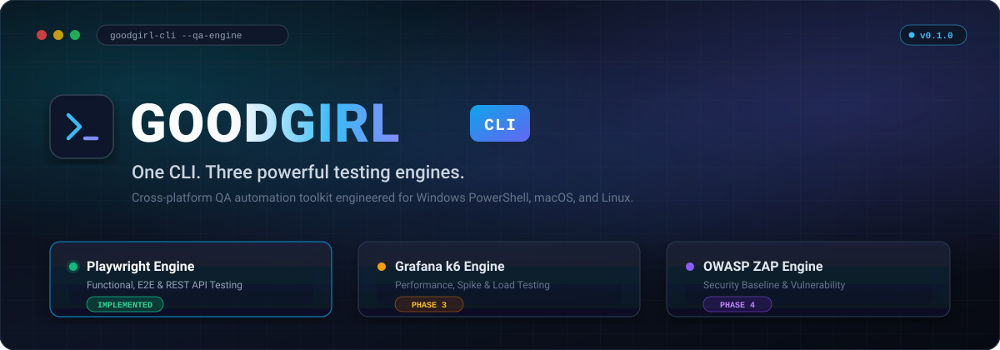
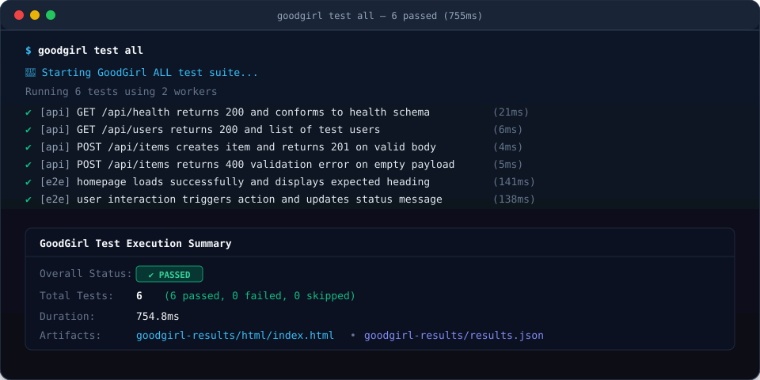
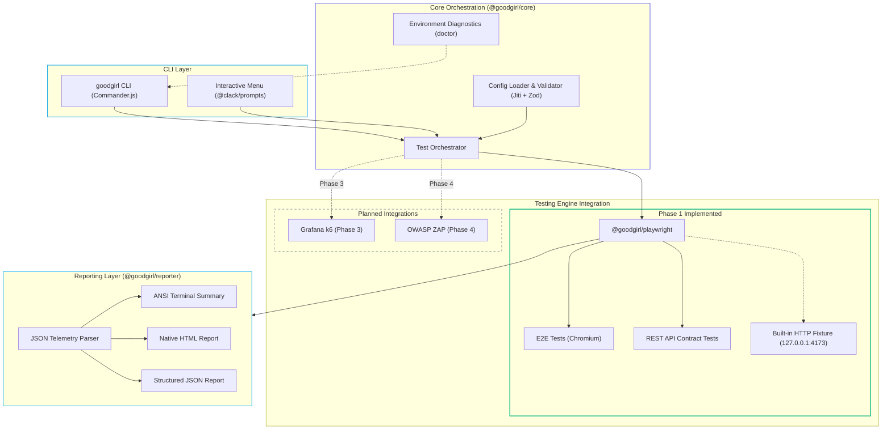

<div align="center">



# GoodGirl CLI

**One CLI. Three powerful testing engines.**

A cross-platform, CLI-first QA automation toolkit engineered with TypeScript, pnpm Workspaces, Turborepo, and Playwright. Orchestrate end-to-end browser tests and REST API contract suites seamlessly across Windows PowerShell, macOS, and Linux.

[](https://github.com/Loydie123/goodgirl/actions/workflows/ci.yml)


<p align="center">
  <a href="#overview">Overview</a> •
  <a href="#quick-start">Quick Start</a> •
  <a href="#command-reference">Commands</a> •
  <a href="#testing-engines">Engines</a> •
  <a href="#architecture">Architecture</a> •
  <a href="#configuration">Configuration</a> •
  <a href="#roadmap">Roadmap</a>
</p>

</div>

---

## Overview

GoodGirl CLI is built for QA engineers who want a unified, deterministic command-line experience without the overhead of browser extensions, heavy GUI wrappers, or cloud vendor lock-in.

- **Unified QA Tooling**: Run functional browser journeys and REST API contract suites through one unified tool.
- **Interactive & Headless Parity**: Choose between a guided `@clack/prompts` terminal UI for manual exploratory verification and high-speed CLI flags for CI/CD runners.
- **Cross-Platform by Design**: Developed on macOS and engineered specifically for Windows PowerShell parity using Node.js path utilities and `cross-spawn`.
- **Hermetic Testing Out of the Box**: Includes a native local HTTP fixture application (`127.0.0.1:4173`) that lets you verify tests locally without external servers or internet access.
- **Actionable Reporting**: Produces clean terminal tables alongside native Playwright HTML reports and structured JSON payloads.

---

## Terminal Preview



```bash
$ goodgirl test all

🚀 Starting GoodGirl ALL test suite...

Running 6 tests using 2 workers
  ✔  1 [api] › GET /api/health returns 200 and conforms to health schema (21ms)
  ✔  2 [api] › GET /api/users returns 200 and list of test users (6ms)
  ✔  3 [api] › POST /api/items creates item and returns 201 on valid body (4ms)
  ✔  4 [api] › POST /api/items returns 400 with validation error when payload is empty (5ms)
  ✔  5 [e2e] › homepage loads successfully and displays expected heading (141ms)
  ✔  6 [e2e] › user interaction triggers action and updates status message (138ms)

────────────────────────────────────────────────────────
 GoodGirl Test Execution Summary
────────────────────────────────────────────────────────
  Overall Status:  ✔ PASSED
  Total Tests:     6 | Passed: 6 | Failed: 0 | Skipped: 0
  Duration:        755ms
  HTML Report:     /goodgirl/goodgirl-results/html/index.html
  JSON Report:     /goodgirl/goodgirl-results/results.json
────────────────────────────────────────────────────────
```

---

## Testing Engines

GoodGirl is architected to unify three foundational QA disciplines under one CLI interface:

| Engine | Discipline | Capabilities | Phase Status |
|:---|:---|:---|:---:|
| **Playwright** | Functional & API | Headless/headed browser automation, Chromium/Firefox/WebKit execution, REST contract validation, automated tracing, screenshot captures | **Implemented (Phase 1)** |
| **Grafana k6** | Performance & Load | Virtual user load simulation, latency percentiles, failure thresholds, spike and soak testing | *Planned (Phase 3)* |
| **OWASP ZAP** | Application Security | Automated baseline vulnerability scanning, passive proxy inspection, security rule enforcement | *Planned (Phase 4)* |

> [!NOTE]
> Phase 1 delivers complete, production-ready **Playwright** functional E2E and REST API testing. Grafana k6 and OWASP ZAP integrations are planned for future phases and are not yet executable.

---

## Quick Start

### Windows (PowerShell)

```powershell
# 1. Clone repository
git clone https://github.com/Loydie123/goodgirl.git
Set-Location goodgirl

# 2. Install dependencies
pnpm install --frozen-lockfile

# 3. Build workspace packages
pnpm build

# 4. Install Playwright Chromium browser
pnpm exec playwright install chromium

# 5. Run environment diagnostics
pnpm qa doctor

# 6. Execute all smoke tests
pnpm qa test all
```

### macOS & Linux

```bash
# 1. Clone repository
git clone https://github.com/Loydie123/goodgirl.git
cd goodgirl

# 2. Install dependencies
pnpm install --frozen-lockfile

# 3. Build workspace packages
pnpm build

# 4. Install Playwright Chromium browser
pnpm exec playwright install chromium
# (Ubuntu/Debian: if system libraries are needed, run: pnpm exec playwright install --with-deps chromium)

# 5. Run environment diagnostics
pnpm qa doctor

# 6. Execute all smoke tests
pnpm qa test all
```

---

## Interactive CLI

Launch GoodGirl without arguments to start the interactive terminal menu:

```bash
pnpm qa
```

```text
GoodGirl CLI — Interactive QA Menu
┌  Select an action:
│  ● Run E2E Tests       (Execute end-to-end browser tests)
│  ○ Run API Tests       (Execute API endpoint test suite)
│  ○ Run All Tests       (Execute full E2E and API test suite)
│  ○ Generate Report     (View latest HTML or JSON test report)
│  ○ Check Environment   (Validate system prerequisites & config)
│  ○ Exit                (Close GoodGirl CLI)
└
```

Both interactive selections and direct command executions route through identical underlying services.

---

## Command Reference

| Command | Options | Description |
|---|---|---|
| `goodgirl` | *(none)* | Opens interactive terminal menu |
| `goodgirl --help` | `-h, --help` | Displays command reference |
| `goodgirl --version` | `-V, --version` | Prints installed version (`0.1.0`) |
| `goodgirl init` | `-f, --force` | Scaffolds `goodgirl.config.ts`, `tests/e2e/`, and `tests/api/` |
| `goodgirl doctor` | *(none)* | Diagnoses Node.js, pnpm, OS, Playwright, config, and permissions |
| `goodgirl test all` | `--headed`, `--grep <pat>`, `-c, --config <path>` | Runs both E2E browser and REST API test suites |
| `goodgirl test e2e` | `--headed`, `--grep <pat>`, `-c, --config <path>` | Runs only E2E browser test cases |
| `goodgirl test api` | `--grep <pat>`, `-c, --config <path>` | Runs only REST API test cases |
| `goodgirl report` | `-f, --format <html\|json>` | Displays HTML report location or outputs raw JSON |

---

## Configuration

GoodGirl detects and validates `goodgirl.config.ts` using strict Zod schemas and Jiti runtime compilation:

```typescript
import type { GoodGirlConfig } from "@goodgirl/shared";

const config: GoodGirlConfig = {
  projectName: "E-Commerce App QA",
  baseURL: "https://staging.example.com",
  browser: "chromium",
  timeout: 30000,
  retries: 1,
  screenshots: "only-on-failure",
  trace: "retain-on-failure",
  testDir: "tests",
  resultsDir: "goodgirl-results",
};

export default config;
```

### Environment Variable Overrides

Sensitive targets or runtime preferences can be specified without modifying code:

| Variable | Target Property | Example |
|---|---|---|
| `GOODGIRL_BASE_URL` | `baseURL` | `http://localhost:3000` |
| `GOODGIRL_BROWSER` | `browser` | `chromium`, `firefox`, `webkit` |
| `GOODGIRL_TIMEOUT` | `timeout` | `45000` |
| `GOODGIRL_RETRIES` | `retries` | `2` |

---

## Creating & Running Tests

### 1. Local Fixture Test Bench (Hermetic)
When `baseURL` contains port `4173` (the default), GoodGirl automatically starts its built-in local Node.js fixture server. You can immediately run sample E2E and API suites without running any external application.

### 2. Testing an External Application
To target an active web service:
1. Update `baseURL` in `goodgirl.config.ts` or set `GOODGIRL_BASE_URL`.
2. Write tests under `tests/e2e/` or `tests/api/` using standard Playwright syntax:

```typescript
// tests/e2e/login.spec.ts
import { test, expect } from "@playwright/test";

test.describe("Authentication", () => {
  test("user submits credentials and reaches dashboard", async ({ page }) => {
    await page.goto("/login");
    await page.locator("#username").fill("qa_engineer");
    await page.locator("#password").fill("SuperSecret123!");
    await page.locator("button[type=submit]").click();

    await expect(page.locator("h1")).toHaveText("Dashboard");
  });
});
```

```typescript
// tests/api/health.spec.ts
import { test, expect } from "@playwright/test";

test.describe("API Health", () => {
  test("GET /api/health responds with 200 and ok status", async ({ request }) => {
    const res = await request.get("/api/health");
    expect(res.status()).toBe(200);

    const body = await res.json();
    expect(body.status).toBe("ok");
  });
});
```

---

## Test Reporting & Artifacts

All test results are captured under `goodgirl-results/` (gitignored):

```
goodgirl-results/
├── html/             # Self-contained native Playwright HTML report
│   └── index.html
└── results.json      # Complete execution telemetry in structured JSON
```

- **Open HTML Report**: Run `pnpm qa report --format html` or `pnpm exec playwright show-report goodgirl-results/html`.
- **Stream JSON Report**: Run `pnpm qa report --format json` for CI/CD metric pipelines.

---

## Architecture



### Monorepo Structure

```
goodgirl/
├── apps/
│   └── cli/                # GoodGirl CLI executable, commands, and Clack UI
├── packages/
│   ├── core/               # Test runner orchestrator, Zod validator, diagnostics
│   ├── playwright/         # Playwright config factory, tests, and fixture server
│   ├── reporter/           # Result parser and ANSI terminal summary formatter
│   └── shared/             # Domain types, constants, path helpers, custom errors
├── examples/
│   └── sample-project/     # Standalone QA sample project
├── assets/                 # Custom SVG branding and terminal previews
├── .github/workflows/      # Cross-platform matrix CI (Windows, macOS, Linux)
├── pnpm-workspace.yaml
├── turbo.json
└── package.json
```

---

## Development Scripts

| Command | Action |
|---|---|
| `pnpm build` | Compiles all workspace packages via Turborepo (`tsup`) with declarations |
| `pnpm dev` | Starts interactive watch mode across workspace packages |
| `pnpm lint` | Validates code quality and style using ESLint 9 |
| `pnpm typecheck` | Runs strict TypeScript type-checking across all workspaces |
| `pnpm test` | Executes Vitest unit tests across all packages |
| `pnpm qa` | Runs GoodGirl CLI directly without global installation |

---

## Troubleshooting

### 1. Missing Browser Binary
```text
Error: Cannot find Playwright browser binary
```
**Resolution**: Run `pnpm exec playwright install chromium`. On Linux runners, use `pnpm exec playwright install --with-deps chromium`.

### 2. Port `4173` Already Bound
```text
Error: listen EADDRINUSE: address already in use 127.0.0.1:4173
```
**Resolution**: Another application is using port 4173. Override the port via config or environment variable:
```powershell
$env:GOODGIRL_BASE_URL = "http://127.0.0.1:4174"
pnpm qa test all
```

### 3. CI Terminal Menu Hangs
**Resolution**: `@clack/prompts` requires an interactive TTY. In headless CI/CD pipelines, always pass explicit subcommands (e.g., `pnpm qa test all` or `pnpm qa doctor`).

---

## Roadmap

- **Phase 1 (Completed)**: Monorepo foundation, Commander CLI, Clack interactive UI, Playwright E2E/API integration, local fixture server, unified reporting, cross-platform CI matrix.
- **Phase 2 (Next)**: Multi-browser Matrix (Firefox, WebKit), visual regression snapshot testing, execution history database.
- **Phase 3 (Planned)**: Grafana k6 engine integration for performance, spike, and load testing.
- **Phase 4 (Planned)**: OWASP ZAP engine integration for automated security baseline scanning.

---

## Contributing

Please review [CONTRIBUTING.md](CONTRIBUTING.md) for local development workflows, cross-platform coding rules, and Conventional Commit guidelines.

---

## License

License decision is currently pending.
